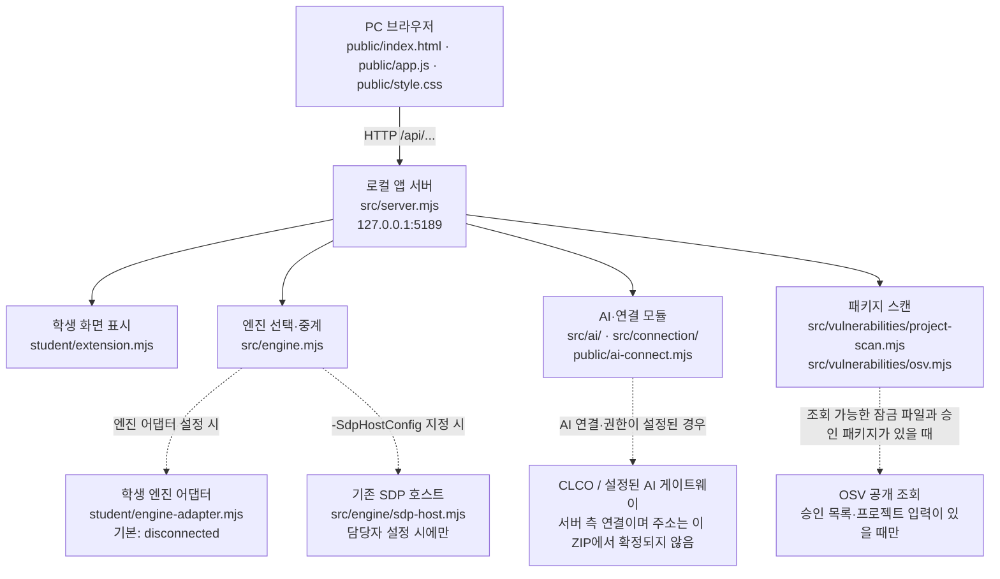

# 학생용 실행 설명서와 시스템 구성도

이 문서는 ALEPH 21단계용 학생 문서입니다. 설명은 현재 프로젝트의 파일과 계약을 기준으로 작성했습니다. 서버는 문서에 적힌 명령을 대신 실행하지 않으며, 문서 작성만으로 실제 PC 실행·SDP/XDR 연결·AI 요청·단계 통과가 확인되는 것은 아닙니다.

## 1. 목적과 지원 범위

앱은 로그인·기기·세션 상태, 사용자 범위 업무 앱, 접근 판정, 접속/XDR 기록을 보여 줍니다. 설정과 권한이 준비된 경우 AI 연결·사건 설명과 설치 패키지의 공개 취약점 조회 경로도 제공됩니다. 기본 실행은 연결 없음(disconnected)이며, `--demo`/`npm run demo`는 예제 데이터일 뿐 실제 시스템 연결이 아닙니다.

이 과제에서 사용하는 Agent 이름은 **복수를결심한인공능지**입니다. 제공 시작 틀의 브라우저 제목과 실행 안내 문구는 기본 이름 **케셰브**입니다. 포털에서 지정한 이름이 화면 제목에 자동으로 반영되지는 않습니다. 이 단계에서는 앱 화면·기능 이름을 임의로 변경하지 않습니다.

| 항목 | 현재 코드에서 확인한 범위 |
|---|---|
| 운영체제·실행 셸 | `tools/start-alekov.ps1`을 사용하는 Windows PowerShell 실행 절차가 제공됨. 다른 셸은 이 설명서에서 검증하지 않음 |
| Node.js | `package.json`의 권장·수업 기준은 `24.19.0`. PowerShell 실행 도구는 Node.js 22~24를 허용하고 24.19.0이 아니면 참고 메시지를 표시함 |
| npm 의존성 | `package.json`에 dependencies/devDependencies가 없으며, 별도 npm 설치 단계는 없음 |
| 브라우저 주소 | 기본 `http://127.0.0.1:5189/`; 로컬 PC(loopback)에서 접속 |
| 제공/학생 코드 | 제공 서버·UI와 학생 렌더러는 파일과 함수가 분리됨. 아래 표 참조 |
| 실제 연결 | SDP 호스트 설정, 앱 인증/AI 승인 등은 별도 조건. 기본 실행만으로 연결됐다고 판단할 수 없음 |

업로드된 ZIP에는 `package-lock.json`, 별도 `aleph.config.json`, `.git` 디렉터리가 없습니다. 따라서 이 압축본만으로는 실제 저장소 최상위 경로·원격 주소·제출 커밋을 판정할 수 없으며, 프로젝트에 별도 잠금 파일이 있다고 가정하지 않습니다. 취약점 조회 결과도 이 ZIP만으로 실제 패키지 목록을 확인했다고 기록하지 않습니다.

## 2. 실행·종료·재실행

### 준비와 작업 위치

1. Node.js `24.19.0`을 권장 버전으로 설치합니다. `node --version`으로 확인합니다. 실행 도구가 허용하는 범위는 Node.js 22~24이지만, 권장 버전과 실제 허용 범위를 혼동하지 않습니다.
2. 파일 탐색기에서 앱 폴더 `on-client`를 엽니다.
3. 폴더 주소 표시줄에 `powershell`을 입력하고 Enter를 눌러, 현재 위치가 `on-client`인 PowerShell 창을 엽니다.
4. 이 폴더에서 아래 명령을 실행합니다.

```powershell
powershell -NoProfile -ExecutionPolicy Bypass -File .\tools\start-alekov.ps1
```

`-ExecutionPolicy Bypass`는 위 PowerShell 실행에만 전달되며 시스템의 실행 정책을 영구 변경하지 않습니다. 이 스크립트는 Node.js 버전, 앱 폴더 구성과 포트 사용 여부를 확인하고 `src/server.mjs`를 실행합니다. 패키지를 설치하거나 기존 프로세스를 강제 종료하지 않습니다.

### 정상 시작 신호와 브라우저

기본 포트에서 시작했을 때 다음 안내가 출력됩니다.

```text
케셰브가 켜졌습니다. 브라우저에서 http://127.0.0.1:5189/ 을 여세요.
서버가 응답한 것만 확인했습니다. AI 연결 상태는 화면에서 따로 확인해 주세요.
```

첫 문구는 실행 도구가 로컬 주소의 HTTP 200 응답을 확인했다는 뜻입니다. 두 번째 문구의 의미를 그대로 적용해야 하며, AI·SDP·XDR 연결 완료 신호로 해석하면 안 됩니다. 브라우저에서 `http://127.0.0.1:5189/`를 열어 `보호 현황` 화면이 표시되는지 확인합니다. 상단 상태는 실제 연결 상태에 따라 달라질 수 있습니다.

### 선택 명령

```powershell
# 기본 포트 5189가 사용 중일 때 다른 포트 사용
powershell -NoProfile -ExecutionPolicy Bypass -File .\tools\start-alekov.ps1 -Port 5190

# 화면 예제 데이터 사용: 실제 연결 성공이 아님
powershell -NoProfile -ExecutionPolicy Bypass -File .\tools\start-alekov.ps1 -Demo

# 백그라운드 실행: 도구가 출력하는 프로세스 번호를 기록
powershell -NoProfile -ExecutionPolicy Bypass -File .\tools\start-alekov.ps1 -Background
```

포트를 `5190`으로 바꿨다면 브라우저도 `http://127.0.0.1:5190/`으로 엽니다. 백그라운드 모드에서는 안내된 프로세스 번호의 `node` 프로세스를 작업 관리자에서 종료합니다. 기본 실행에서는 앱 PowerShell 창에서 `Ctrl+C`를 눌러 종료합니다. 다시 켤 때는 같은 앱 폴더에서 실행 명령을 다시 실행합니다.

`npm start`도 `node src/server.mjs`를 실행하지만 `start-alekov.ps1`의 사전 점검을 거치지 않습니다. `npm run demo`는 `node src/server.mjs --demo`를 실행합니다. `npm run check`는 `node --check student/extension.mjs`만 수행하며 런타임 화면·연결·API 결과 검사는 아닙니다. 이 패키지 구성에는 설치할 npm dependency가 없으므로 문서화된 실행 절차에 `npm install`을 추가하지 않습니다.

## 3. 글로 쓴 시스템 구성도



- 브라우저는 로컬 앱 서버의 API만 호출합니다. 이 코드에서 브라우저가 직접 SDP/XDR 원천이나 CLCO에 접속하는 구조로 문서화하지 않습니다.
- `src/server.mjs`는 정적 UI와 `/api/...` 라우트를 제공하고, `src/engine.mjs`가 엔진을 불러옵니다. 기본 실행은 연결 어댑터가 없을 때 `disconnected` 상태입니다.
- SDP 설정은 실행 도구의 `-SdpHostConfig "C:\경로\설정파일.json"` 옵션으로 선택합니다. 설정 파일 경로나 비밀값은 제출 문서에 적지 않습니다. 이 옵션은 담당자가 별도 파일을 제공한 경우에만 사용합니다.
- AI 연결과 사건 설명은 `src/ai/` 및 `src/connection/`의 서버 측 서비스와 `public/ai-connect.mjs`의 화면 흐름을 사용합니다. 연결 상태·권한 확인은 별도이며, 로컬 서버가 켜진 사실만으로 AI가 연결된 것은 아닙니다.
- 패키지 취약점 조회는 `src/vulnerabilities/`에서 처리합니다. 공개 조회는 구현된 승인 정책을 따릅니다. 이 ZIP에는 `package-lock.json`이 없으므로 실제 설치 패키지 결과는 미확인입니다.
- ALEPH 포털은 코드 제출과 단계 판정을 위한 별도 시스템입니다. 이 앱의 로컬 실행 흐름에 포함시키지 않습니다. 21단계 서버 판정은 제출한 소스·문서·구성도와의 대조이며 문서 명령을 서버가 실행하는 검사가 아닙니다.

## 4. API·상태·학생 함수 계약

### 공통 API 응답

서버의 공통 `send()` 함수는 응답 본문에 `meta`를 추가합니다. 응답은 성공 시 `{ "ok": true, "data": ..., "meta": { "mode": ..., "checkedAt": ..., "starterVersion": ... } }`, 실패 시 `{ "ok": false, "error": { "code": ..., "message": ..., "retryable": ... }, "meta": ... }` 형태입니다. `meta.mode`의 허용 상태는 `connected`, `demo`, `disconnected`이며 클라이언트에서 알 수 없는 값은 별도로 확인 불가로 처리됩니다. `/api/diagnostics`도 `meta`를 받지만, 별도 `data.version` 필드가 있습니다. API 경로·상태값·함수명은 이 문서에서 임의로 변경하지 않습니다.

| 메서드·경로 | 실제 입력 계약 / 목적 |
|---|---|
| `GET /api/me` | 현재 로그인·기기·세션 정보 |
| `GET /api/apps` | 현재 사용자에게 표시되는 업무 앱 목록 |
| `POST /api/access` | JSON `{ "appId": "..." }`; 해당 앱의 접근 판정 요청 |
| `GET /api/events` | 현재 사용자 범위의 접속/XDR 기록 |
| `GET /api/devices`, `GET /api/sessions` | 현재 사용자 범위 기기·세션 목록 |
| `GET /api/diagnostics` | 비밀 없는 엔진·AI 연결 진단; 응답 버전 필드와 패키지 버전은 동일하다고 가정하지 않음 |
| `GET /api/vulnerabilities` | 현재 서버에 구성된 프로젝트 스캐너 조회 |
| `POST /api/ai/check` | JSON `{}`; 현재 앱 권한으로 모델 목록·연결 점검. 실제 사건 설명 요청과 다름 |
| `POST /api/ai/explain` | JSON `{ "eventId": "..." }`; 선택한 기록에 대한 AI 설명 요청 |
| `POST /api/ai/connect/start` | 앱 연결 시작 |
| `POST /api/ai/connect/finish`, `/status`, `/cancel` | 연결 작업의 `connectionId`를 사용해 승인 결과 확인·상태 확인·취소 요청 |
| `POST /api/actions/prepare`, `/execute`, `/result` | 조치 제안 준비·확인 후 실행 요청·결과 조회 계약. 실제 원천 집행과 권한 연결은 별도이며 기본 실행에서 가능하다고 보지 않음 |

`student/extension.mjs`는 `public/app.js`가 제공하는 렌더러 계약을 따릅니다. 제공 UI는 학생 함수에 상태 스냅샷을 전달하고, 반환값은 DOM `Element`, 텍스트 또는 `null`이어야 합니다. 학생 함수가 오류를 내거나 잘못된 반환 형식을 주더라도 제공 UI가 별도의 오류 상태를 표시하도록 되어 있습니다.

| 학생 함수 | 제공 UI가 전달하는 입력의 주요 필드 | 화면 슬롯 |
|---|---|---|
| `renderIdentity` | `me`, `devices`, `sessions` 리소스 스냅샷 | `student-identity` |
| `renderDecision` | `status`, `mode`, `data`, `error`, `appId` | `student-decision` |
| `renderEvents` | `status`, `mode`, `data`, `error` | `student-events` |
| `renderStatus` | `devices`, `sessions`, `notifications`, `diagnostics`, `mode` | `student-status` |
| `renderVulnerabilities` | `status`, `mode`, `data`, `error` | `student-vulnerabilities` |
| `renderAiConnection` | `status`, `mode`, `data`, `error`, `checkedAt`, `explanationAccepted` | `student-ai-connection` |
| `renderExplanation` | 선택된 `event`, `explanation` 리소스, `checkedAt` | `student-explanation` |
| `renderAction` | 조치 상태 객체(`status`, `event`, `actionId` 등) | `student-action` |

제공 UI는 `api.get()`에 대해 `/api/me`, `/api/apps`, `/api/events`, `/api/devices`, `/api/sessions`, `/api/vulnerabilities`만 허용합니다. 현재 `public/app.js`는 `createStudentView`에 `api`와 `onChange`를 전달하지만, `student/extension.mjs`의 팩토리는 `onChange`만 구조 분해해 받습니다. 이 차이를 문서 작성 단계에서 임의로 바꾸거나 API 경계를 넓히지 않습니다. 관련 `data-*` 식별자, 버튼 이름, API 상태값은 기존 계약을 기준으로 유지해야 합니다.

## 5. 제공 코드와 학생 작성 코드

| 경계 | 파일 | 책임과 제한 |
|---|---|---|
| 제공 UI | `public/index.html`, `public/app.js`, `public/style.css`, `public/vulnerabilities-view.mjs`, `public/ai-connect.mjs` | 탭·버튼·요청·응답 검증·공통 상태·학생 렌더러 호출·AI 연결 화면 흐름. 이 단계에서 수정하지 않음 |
| 제공 API 서버 | `src/server.mjs` | 정적 파일, API 입력 검증, 상태 코드와 안전한 오류 응답, 엔진·AI·스캔 서비스 연결. 이 단계에서 수정하지 않음 |
| 엔진 경계 | `src/engine.mjs`, `src/engine/sdp-host.mjs`, `src/engine/sdp-host-config.mjs`, `student/engine-adapter.mjs` | 기존 사용자 범위 정보·앱 판정을 연결할 경계. 기본은 disconnected; 임의 사용자나 XDR 전체 조회를 학생 범위로 꾸며서는 안 됨 |
| AI·연결 | `src/ai/`, `src/connection/`, `vendor/clco-http.mjs` | 앱 연결, 권한·자격 처리, 서버 측 AI 게이트웨이 요청. 비밀은 문서·학생 UI에 노출하지 않음 |
| 취약점 조회 | `src/vulnerabilities/project-scan.mjs`, `src/vulnerabilities/osv.mjs` | 승인 정책에 따른 공개 패키지 조회. 미조회·오류·확인 불가를 취약점 없음으로 바꾸지 않음 |
| 학생 표시 | `student/extension.mjs` | 위 계약에 맞춰 학생 전용 슬롯을 렌더링하는 영역. 앞 단계 함수와 `data-*` 계약을 임의로 바꾸지 않음 |
| 실행 도구 | `tools/start-alekov.ps1` | Node 버전·폴더·포트를 확인하고 로컬 서버를 실행; 설치, 기존 프로세스 종료, AI 연결 성공 판정은 하지 않음 |

원본 소스 검토에서 `student/extension.mjs` 내부에 `renderVulnerabilities` 정의가 두 번 나타납니다. JavaScript 객체 리터럴에서는 뒤쪽 정의가 앞쪽 정의를 덮습니다. 이번 단계는 문서 작성이므로 이 기존 구현은 여기서 수정하지 않았으며, 실제 렌더링 계약은 뒤쪽 정의를 기준으로 대조해야 합니다.

## 6. 오류 확인과 복구 순서

오류가 생기면 **같은 작업 폴더 → 정확한 명령 → 콘솔의 전체 메시지 → 브라우저 주소·포트 → 화면의 상태/오류 코드 → 도움정보** 순서로 확인합니다. 원인을 모른 채 연결 성공으로 기록하거나, 기존 작업 폴더·파일을 삭제해 해결하지 않습니다.

| 관찰된 상태·메시지 | 실제 의미 | 확인·복구 방법 |
|---|---|---|
| `Node.js 가 없습니다` | 실행 도구가 `node`를 찾지 못함 | Node.js `24.19.0`을 설치하고 새 PowerShell 창에서 `node --version`을 확인 |
| `지금 Node.js 는 vXX 입니다` | 실행 도구가 지원 범위 밖 버전을 감지함 | Node.js 22~24를 사용하고, 수업·검수 기준인 `24.19.0` 권장 |
| `포트 5189 를 다른 프로그램이 쓰고 있습니다` | 기본 포트를 바인딩할 수 없음 | 기존 프로그램을 종료하지 말고 `-Port 5190`으로 실행한 뒤 브라우저 포트도 `5190`으로 변경 |
| `앱 폴더가 아닙니다` / `시작 틀 폴더가 아닙니다` | `tools`, `src/server.mjs`, `package.json` 또는 시작 틀 이름 검사가 맞지 않음 | 실제 `on-client` 폴더에서 실행하고 필요한 제공 파일이 있는지 확인 |
| `바로가기(링크)로 연결된 폴더` | 실행 경로가 reparse point/symlink로 확인됨 | 바로가기 대신 실제 프로젝트 폴더에서 실행 |
| 앱 서버가 제한 시간 안에 뜨지 않음 | 실행 도구가 주소에서 HTTP 200을 확인하지 못함 | 콘솔의 오류 전체를 보존하고 Node 버전·포트·파일 경로를 확인; 추측으로 서버 성공 처리 금지 |
| 화면 상태 `연결 없음` 또는 `ENGINE_NOT_CONNECTED` | 엔진 연결이 기본 미설정이거나 현재 연결을 확인할 수 없음 | 기본 실행이라면 가능한 상태. 실제 SDP 연결은 담당자가 제공한 설정과 현재 사용자 범위를 확인 |
| `ENGINE_ADAPTER_INVALID`, `ENGINE_RESULT_UNVERIFIED`, `SUBJECT_SCOPE_UNVERIFIED` | 어댑터 계약·응답 또는 현재 사용자 범위를 확인할 수 없음 | `docs/CONNECTION_TROUBLESHOOT.md`에서 코드별 확인을 진행하고 담당자에게 비밀 없는 도움정보 전달 |
| AI `ON_AI_PROVISIONING_PENDING` 또는 `WB_CLCO_*` 오류 | 앱 권한·AI 연결·게이트웨이 응답 등에서 오류가 발생했거나 준비되지 않음 | 화면의 정확한 코드와 도움정보를 확인하고 담당자 안내를 따름. 키를 코드나 채팅에 붙여 넣지 않음 |
| 패키지 조회 실패·미조회·확인 불가 | 현재 정보만으로 전체 조회 결과를 확인하지 못함 | 프로젝트 잠금 파일과 승인 범위, 화면의 `status`를 확인. 이를 취약점 없음으로 간주하지 않음 |

도움정보는 보호 현황의 `도움정보 불러오기`로 화면에 표시하고 내용을 직접 확인한 뒤 `확인했으며 복사합니다`를 누를 때만 복사합니다. `AI 연결` 영역의 `연결 도움정보 보기`도 같은 원칙으로 다룹니다. 도움정보를 자동 전송한다고 문서화하지 않습니다.

## 7. 확인 결과와 미확인 범위

다음 표는 **소스에서 확인한 계약**과 **실제로 실행해서 확인해야 하는 항목**을 분리합니다. 코드 검토 결과를 브라우저 실행·운영 연결 증거로 대신하지 않습니다.

| 항목 | 현재 근거 | 판정 범위 |
|---|---|---|
| 실행 도구가 Node.js·폴더·포트 검사 후 서버를 실행함 | `tools/start-alekov.ps1` 코드 | 소스 검토 완료; 사용자의 Windows PC에서 실행됐는지는 별도 확인 필요 |
| 서버가 `127.0.0.1`에 바인딩하고 `/`와 API를 제공함 | `src/server.mjs` 코드 | 소스 검토 완료; 사용자 브라우저의 실제 표시 여부는 미확인 |
| 기본 엔진 연결 없음 및 demo 경로 | `src/engine.mjs`, `src/server.mjs` 코드 | 코드상 확인; 실제 SDP/XDR 운영 데이터는 미확인 |
| AI 계정 연결·AI 게이트웨이 | `src/ai/`, `src/connection/`, `public/ai-connect.mjs` | 구현 경계는 확인; 실제 자격·권한·모델 응답은 미확인 |
| 실제 공개 취약점 조회 | `src/vulnerabilities/` 코드; 업로드 ZIP에는 `package-lock.json` 없음 | 이번 ZIP에서 실제 프로젝트 패키지 조회는 미확인 |
| 실제 원천 조치 집행 | `/api/actions/...` 서버 계약 | 코드 경계만 확인; 운영 원천·실제 집행은 미확인 |
| README·설명서의 실행 절차를 사용자가 직접 따라 하는 과정 | 사용자 PC 실행 로그가 아직 없음 | 미확인 |
| ALEPH 제출 판정·원문 수집 | 포털의 실제 접수 결과가 아직 없음 | 미확인; 문서 작성은 통과 결과가 아님 |

코드에서 추가로 확인한 차이: `package.json`의 프로젝트 버전은 `0.2.11`이지만 `GET /api/diagnostics`의 `version` 필드는 `0.1.0`입니다. 두 값을 동일하다고 적지 않습니다. 이번 문서 단계에서는 제공 서버의 버전 필드를 임의로 수정하지 않습니다.

## 8. 21단계 제출 전 보존 메모

- 학생 문서와 이번 단계에서 실제 변경한 문서를 함께 커밋합니다. 이 문서 작성 작업에서는 제공 서버·`public/app.js`·인증 설정을 수정할 필요가 없습니다.
- 이 ZIP에는 `.git`이 없으므로 여기서는 실제 저장소 주소나 40자리 커밋 해시를 기재하지 않습니다. 이미 연결된 본인 저장소의 실제 작업 폴더에서 확인합니다.
- 21·22단계는 과제 화면에 저장소 주소와 40자리 커밋을 직접 입력하는 경로를 사용합니다. 비공개 저장소는 공개로 바꾸지 않습니다. 비공개 원문 준비는 해당 단계 화면의 「비공개 저장소 원문 준비 방법」과 `student-source-cli.mjs` 안내를 그대로 따르며, 여기서 도구 경로·명령 인자·커밋 값을 임의로 만들지 않습니다.
- 원문 전달 완료는 AI 검토 통과와 다릅니다. 제출 화면의 단계·저장소·커밋 및 최종 판정 설명을 별도로 확인합니다.
