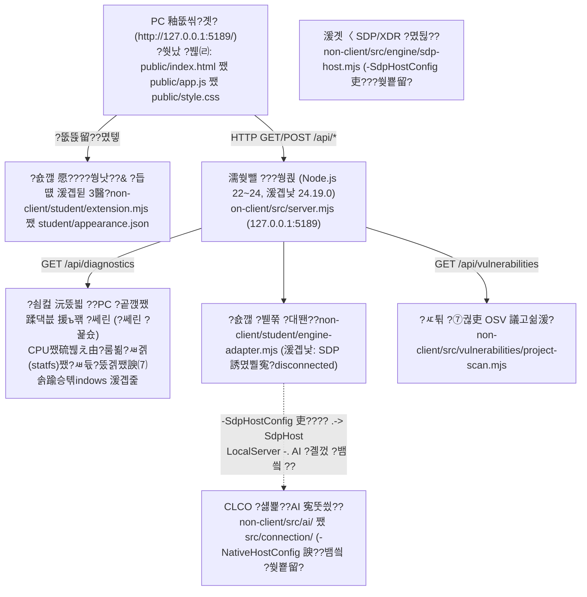

# 蹂듭닔瑜쇨껐?ы븳?멸났?μ? (耳€?곕툕 ZTNA & XDR 蹂댁븞 Agent) ???ㅽ뻾 ?ㅻ챸??諛??쒖뒪??援ъ꽦??
- **臾몄꽌 紐⑹쟻**: 泥섏쓬 蹂대뒗 ?щ엺?????ㅻ챸?쒕쭔 蹂닿퀬 `C:\choi-bujang-secret-vault-main\on-client` ?깆쓣 ?ㅼ튂쨌?ㅽ뻾쨌醫낅즺쨌?ъ떎?됲븯怨? 愿€???€?쒕낫?쒗삎 ?붾㈃怨??듭떖 湲곕뒫 3媛€吏€瑜??뺤씤?????덈룄濡??덈궡?⑸땲??
- **???대쫫**: **蹂듭닔瑜쇨껐?ы븳?멸났?μ?** (?쒓났 ?쒖옉 ?€ 湲곕낯 ?대쫫: **耳€?곕툕 `0.2.11`**, ?쒕쾭 吏꾨떒 硫뷀? 踰꾩쟾: `0.1.0`)
- **蹂댁〈 ?먯튃**: 湲곗〈 1~3李??꾨줈?앺듃 ?대뜑(`C:\choi-bujang-secret-vault-main`)?€ ?대? ?쒖텧???곗텧臾쇱? 吏€?곌굅????린吏€ ?딄퀬 洹몃?濡?蹂댁〈?⑸땲??

## 1. ?쒓났 湲곕뒫怨??닿? 留뚮뱺(諛붽씔) 湲곕뒫??援щ텇

| 援щ텇 | ?뚯씪 寃쎈줈 (`on-client` 湲곗?) | ?대떦 ??븷 諛??댁슜 |
|---|---|---|
| **?쒓났 怨듯넻 湲곕뒫**<br>(?먮낯 怨꾩빟 ?좎?) | `public/index.html`<br>`public/app.js`<br>`public/style.css`<br>`public/ai-connect.mjs`<br>`public/vulnerabilities-view.mjs`<br>`src/server.mjs` (湲곕낯 API)<br>`tools/start-alekov.ps1` | ???곷떒 ?곹깭 諛곗?(`mode-badge`), 醫뚯륫 3媛?硫붾돱 ??`蹂댄샇 ?꾪솴`쨌`?낅Т ??쨌`蹂댁븞 湲곕줉`), `?ㅼ떆 遺덈윭?ㅺ린`, `?꾩??뺣낫 遺덈윭?ㅺ린` 踰꾪듉<br>??`GET /api/diagnostics`??湲곕낯 7媛??꾨뱶(`requestId`, `component`, `version`, `engine.mode`, `engine.code`, `ai`, `checkedAt`) ?쒓났<br>??13~20?④퀎 ?숈깮 ?щ’(`student-identity`, `student-status`, `student-decision`, `student-events`, `student-explanation`, `student-action`, `student-ai-connection`, `student-vulnerabilities`) ?몄텧 |
| **?닿? 留뚮뱺쨌?ㅻ벉?€ 湲곕뒫 1**<br>(愿€???€?쒕낫???€ + ?듭떖 3湲곕뒫 ?곗꽑 諛곗튂) | `student/extension.mjs`<br>`student/appearance.json` | ???붾㈃ 留??꾩뿉 **愿€???€?쒕낫???곷떒 ?곹깭 移대뱶 4醫?*(??SDP ?쒕쾭 ?곌껐 ?곹깭 遺꾨━ 移대뱶, ??湲곌린쨌?몄뀡 蹂댁븞 移대뱶, ????PC ?먯썝 ?붿빟 移대뱶, ????PC 諛⑺솕踰승톆indows 湲곕줉 ?붿빟 移대뱶)怨??꾨옒 **異붿씠쨌湲곕줉 ?곸뿭**??諛곗튂<br>??**?뚮궡 PC ?곹깭쨌蹂댁븞 援ъ꽦 ?ㅼ떆 議고쉶??踰꾪듉**怨??ㅼ떆媛?**?€湲??쒖떆(`??議고쉶 ?€湲?以묅€?)**, ?ㅻ낫??`Tab`쨌`Enter`쨌`Space`) ?묎렐??吏€??br>??`student/extension.mjs` ??以묐났 ?좎뼵?섏뼱 ?덈뜕 `renderVulnerabilities` ?⑥닔瑜??⑥씪 ?뺤쓽濡??뺣━ |
| **?닿? 留뚮뱺쨌?ㅻ벉?€ 湲곕뒫 2**<br>(??PC ?먯썝 ?ㅼ륫 + 吏곸쟾 痢≪젙 ?€鍮?異붿씠 鍮꾧탳쨌?댁꽍) | `student/extension.mjs`<br>(`src/server.mjs` 吏꾨떒 ?뺤옣 ?곕룞) | ???쒓났 `GET /api/diagnostics`??`checkedAt` 洹쇨굅瑜??ъ궗?⑺븯?? ?쇰컲 ?ъ슜??沅뚰븳(`node:os`, `fs.statfs`)?쇰줈 ?쎌? **CPU ?ъ슜瑜?`%`, 肄붿뼱 ??**, **硫붾え由??ъ슜??`GiB`, `%`)**, **?붿뒪???⑥? 怨듦컙(`GiB`, `%`)**??痢≪젙 ?쒓컖쨌?⑥쐞?€ ?④퍡 ?쒖떆<br>??2???댁긽 議고쉶 ??**吏곸쟾 痢≪젙 ?쒓컖 ?€鍮?蹂€?붾웾(? `%p`, `짹GiB`)**怨?**?꾧퀎移?湲곕컲 ?곹깭 ?댁꽍(`?먯썝 ?ъ쑀(?뺤긽)` / `二쇱쓽`)** ?먮룞 ?쒖떆<br>???꾩쭅 議고쉶?섏? ?딆븯嫄곕굹 ?쎌? 紐삵븳 媛믪? ?덉떆 ?レ옄濡?袁몃?吏€ ?딄퀬 **`[?뺤씤 遺덇?]`?€ 援ъ껜?곸씤 ?댁쑀**瑜??쒖떆 |
| **?닿? 留뚮뱺쨌?ㅻ벉?€ 湲곕뒫 3**<br>(?ㅽ듃?뚰겕 쨌 諛⑺솕踰??쎄린 ?꾩슜 쨌 Windows 湲곕줉 嫄댁닔) | `student/extension.mjs`<br>(`src/server.mjs` 吏꾨떒 ?뺤옣 ?곕룞) | ???쇰컲 沅뚰븳 ?쎄린 ?꾩슜?쇰줈 **?쒖꽦 ?ㅽ듃?뚰겕 ?명꽣?섏씠??IPv4쨌?룸쭏?ㅽ겕)**, **Windows 諛⑺솕踰??꾨줈???곹깭(Domain쨌Private쨌Public 耳쒖쭚/爰쇱쭚, ?ㅼ젙 蹂€寃??덈? ?놁쓬)**, **理쒓렐 24?쒓컙 Windows 湲곕줉(`System`쨌`Application`) 寃쎄퀬쨌?ㅻ쪟 嫄댁닔** ?쒖떆<br>???붾㈃??**?뚯씠 嫄댁닔???쇰컲 ?댁쁺泥댁젣 濡쒓렇 ?듦퀎?대ʼn 移⑦빐??怨듦꺽 ?먯? 寃곌낵媛€ ?꾨떃?덈떎??* 諛?**?똕DP 誘몄뿰寃??곹깭??濡쒖뺄 PC 議고쉶 ?깃났怨?蹂꾧컻?낅땲?ㅳ€?*瑜?紐낆떆 |

## 2. ?쒖뒪??援ъ꽦??


## 3. 泥섏쓬 蹂대뒗 ?щ엺???꾪븳 ?ㅼ튂쨌?ㅽ뻾쨌醫낅즺쨌?ъ떎???쒖꽌

### 3.1 ?ъ쟾 以€鍮??뺤씤
1. **Windows PowerShell**(?쇰컲 ?ъ슜??沅뚰븳 李? 愿€由ъ옄 沅뚰븳 遺덊븘?????쎈땲??
2. **Node.js 踰꾩쟾(`22`~`24`, 沅뚯옣 `v24.19.0`)**???뺤씤?⑸땲??
   ```powershell
   node --version
   ```
   - `v18.x` ?댄븯 踰꾩쟾?대㈃ `node:sqlite` 紐⑤뱢??李얠? 紐삵빐 ?쒕쾭媛€ 耳쒖?吏€ ?딆뒿?덈떎. 諛섎뱶??Node.js `22`~`24`(`v24.19.0`)瑜??ъ슜?섏꽭??
3. **?묒뾽 ?대뜑 ?꾩튂 ?뺤씤**:
   - ?꾨줈?앺듃 理쒖긽???대뜑(`C:\choi-bujang-secret-vault-main`)媛€ ?꾨땲?? 洹??덉쓽 **`on-client` ???대뜑**(`C:\choi-bujang-secret-vault-main\on-client`)?먯꽌 ?ㅽ뻾?댁빞 ?⑸땲??
   - `on-client/package.json`?먮뒗 ?몃? npm ?섏〈?깆씠 ?놁쑝誘€濡?**`npm install`???ㅽ뻾?섏? ?딆뒿?덈떎.**

### 3.2 ???ㅽ뻾?섍린
```powershell
cd C:\choi-bujang-secret-vault-main\on-client
npm run check
powershell -NoProfile -ExecutionPolicy Bypass -File .\tools\start-alekov.ps1
```
- PowerShell 李쎌뿉 ?꾨옒 ??以꾩씠 ?섑??섎㈃ ?뺤긽 湲곕룞??寃껋엯?덈떎.
  ```text
  耳€?곕툕媛€ 耳쒖죱?듬땲?? 釉뚮씪?곗??먯꽌 http://127.0.0.1:5189/ ???ъ꽭??
  ?쒕쾭媛€ ?묐떟??寃껊쭔 ?뺤씤?덉뒿?덈떎. AI ?곌껐 ?곹깭???붾㈃?먯꽌 ?곕줈 ?뺤씤??二쇱꽭??
  ```
- ?덉젣 ?먮즺(demo) 紐⑤뱶濡??붾㈃??蹂대젮硫?`-Demo` ?듭뀡??遺숈엯?덈떎(?ㅼ젣 SDP ?곌껐 ?꾨떂):
  ```powershell
  powershell -NoProfile -ExecutionPolicy Bypass -File .\tools\start-alekov.ps1 -Demo
  ```

### 3.3 醫낅즺 諛??ㅼ떆 ?ㅽ뻾?섍린
- **醫낅즺**: ?쒕쾭媛€ 耳쒖쭊 PowerShell 李쎌뿉??`Ctrl+C`瑜??꾨쫭?덈떎.
- **?ㅼ떆 ?ㅽ뻾**: 媛숈? `C:\choi-bujang-secret-vault-main\on-client` ?대뜑?먯꽌 ???ㅽ뻾 紐낅졊???ㅼ떆 ?낅젰?⑸땲??

## 4. ?먯＜ 留됲엳???④퀎?€ ?ㅻ쪟 臾멸뎄蹂??먯씤쨌?닿껐 ?덈궡

?ㅻⅨ ?щ엺???ㅽ뻾 ?덈궡瑜??곕씪 ?섎떎媛€ 留됲삍?????먯씤??**?덈궡(?ㅽ뻾 ?꾩튂쨌?섍꼍)**???덈뒗吏€ **肄붾뱶**???덈뒗吏€ 諛붾줈 ?먮퀎?섎뒗 ?쒖엯?덈떎.

| 留됲엺 ?④퀎 諛??ㅻ쪟 臾멸뎄 | ?먯씤 援щ텇 (?덈궡 vs 肄붾뱶) | ?뺥솗???먯씤 ?ㅻ챸 | ?닿껐 諛⑸쾿 (?꾩슂??議곗튂) |
|---|---|---|---|
| `???대뜑媛€ ?꾨떃?덈떎` ?먮뒗 `-File 留ㅺ컻 蹂€?섏뿉 ?€???몄닔 '.\tools\start-alekov.ps1'??媛€) ?놁뒿?덈떎.` | **?덈궡(?묒뾽 ?대뜑 ?꾩튂)** | ?곸쐞 ?대뜑(`C:\choi-bujang-secret-vault-main`)?먯꽌 紐낅졊???ㅽ뻾?덇린 ?뚮Ц?낅땲?? | `cd C:\choi-bujang-secret-vault-main\on-client`濡??대룞?????ㅽ뻾?⑸땲?? |
| `Error [ERR_UNKNOWN_BUILTIN_MODULE]: No such built-in module: node:sqlite` ?먮뒗 `吏€湲?Node.js ??vXX ?낅땲?? | **?덈궡(Node.js 踰꾩쟾 ?섍꼍)** | ?쒓났 肄붾뱶(`src/actions/store.mjs`)媛€ Node.js 22.5+ ?댁옣 `node:sqlite`瑜??곕뒗?? PC??湲곕낯 Node.js媛€ 18쨌20 踰꾩쟾????諛쒖깮?⑸땲?? | Node.js `24.19.0`(?먮뒗 22~24)???ㅼ튂?섍퀬 **??PowerShell 李?*???댁뼱 ?ㅽ뻾?⑸땲?? |
| `?ы듃 5189 瑜??ㅻⅨ ?꾨줈洹몃옩???곌퀬 ?덉뒿?덈떎` | **?덈궡(?ы듃 以묐났 ?ㅽ뻾)** | ?댁쟾??耳??????쒕쾭 李쎌씠 ?꾩쭅 耳쒖졇 ?덇굅???ㅻⅨ ?꾨줈?몄뒪媛€ 5189 ?ы듃瑜??ъ슜 以묒엯?덈떎. | 湲곗〈 ?꾨줈洹몃옩??媛뺤젣 醫낅즺?섏? 留먭퀬 紐낅졊 ?앹뿉 `-Port 5190`??遺숈뿬 ?ㅽ뻾????`http://127.0.0.1:5190/`?쇰줈 ?묒냽?⑸땲?? |
| `'iscc' ?⑹뼱媛€ cmdlet... ?대쫫?쇰줈 ?몄떇?섏? ?딆뒿?덈떎` | **?덈궡(?몃? ?ㅼ튂 ?꾧뎄 誘몄꽕移?** | Inno Setup(`ISCC.exe`)?€ 湲곕낯 ?쒖옉 ?€???댁옣???꾧뎄媛€ ?꾨땲硫?Windows PATH???놁쓣 ??諛쒖깮?⑸땲?? | 湲곕낯 ???ㅽ뻾쨌?쒖텧?먮뒗 `iscc`媛€ ?꾩슂?섏? ?딆뒿?덈떎. ?ㅼ튂 ?뚯씪(`setup.exe`)??留뚮뱾 ?뚮쭔 `winget install --id JRSoftware.InnoSetup -e --scope user` ?ㅼ튂 ???꾩껜 寃쎈줈濡??ㅽ뻾?⑸땲?? |
| ?붾㈃??`ENGINE_NOT_CONNECTED (?곌껐 ?놁쓬)` ?쒖떆 | **?뺤긽 ?숈옉 (?ㅻ쪟 ?꾨떂)** | 湲곕낯 ?ㅽ뻾?먯꽌??媛쒖씤 SDP ?ㅼ젙(`-SdpHostConfig`)???놁쑝誘€濡?`SDP 誘몄뿰寃?濡??섏삤??寃껋씠 ?뺤긽?낅땲?? | ??PC ?곹깭 ?ㅼ륫?€ **?뚮궡 PC ?곹깭쨌蹂댁븞 援ъ꽦 ?ㅼ떆 議고쉶??*(?먮뒗 `?꾩??뺣낫 遺덈윭?ㅺ린`) 踰꾪듉???뚮윭 ?곕줈 ?뺤씤?⑸땲?? |
